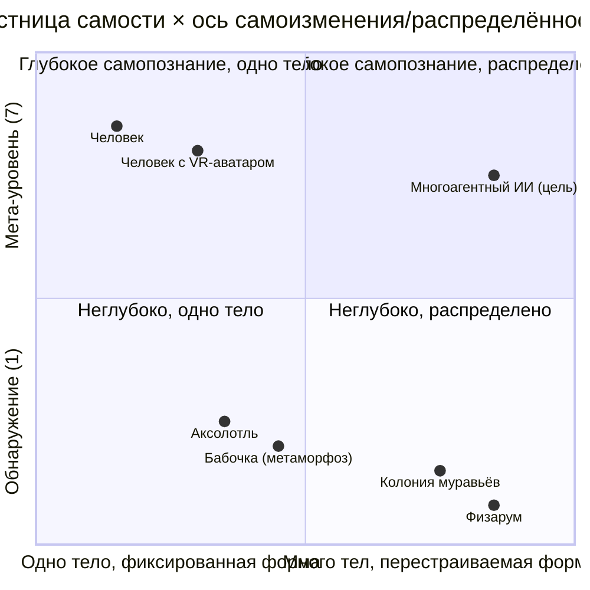

# 🧭 Ось самоизменения и распределённости

**Status:** `RESEARCH INPUT · CANDIDATE · NON-NORMATIVE · NON-CANON · NO_NEW_INVARIANT · NO_RUNTIME_CHANGE` · **Дата:** 2026-10-14

**Связанные файлы:** [03 — лестница самости](03-ladder-of-selfhood.md) · [06 — новые уровни](06-new-levels-self-modification.md)

## Две независимые координаты

- **Лестница самости (вертикаль)** — идёт вверх по **глубине самопознания**: обнаружение → ownership → agency → рефлексия → осознанность → самопонимание → мета-уровень.
- **Ось (горизонталь)** — по **способу существовать**: от **одного тела к многим** и от **фиксированной формы к перестраиваемой**.

Положение на оси не определяет уровень на лестнице, и наоборот.

## Схема (кандидатное, качественное размещение)

Размещение примерное и иллюстративное; положение ИИ — проектная цель, не измерение.

## Смысл для архитектуры

Природа даёт примеры правой части оси (колонии, физарум) только на нижних ступенях лестницы, а человек — верх лестницы на левом краю оси. Кандидатная цель — сочетать глубокое самопознание с распределённостью и перестраиваемостью, сохраняя provenance и границу «своё/чужое» (см. [04](04-threats-probes-forged-mineness-injection.md), [05](05-init-01-unresolved-initiative.md)).
